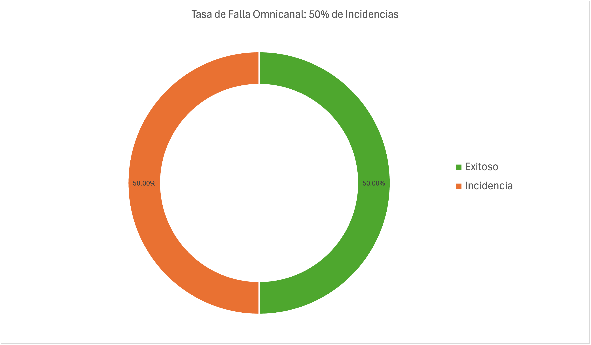
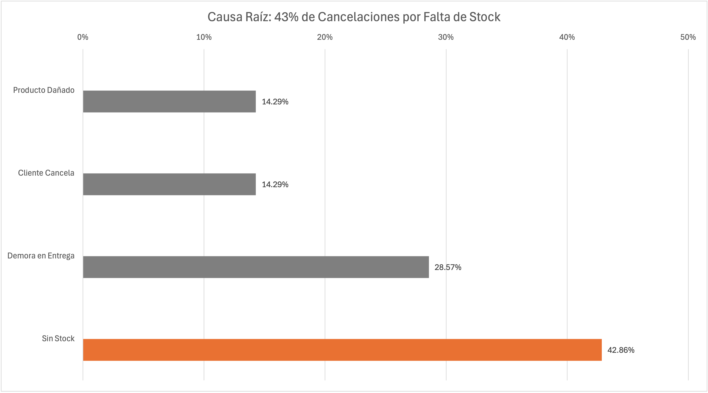
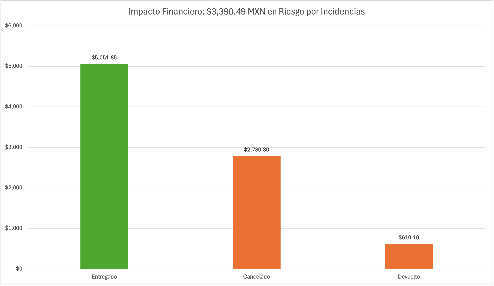

# Walmart México: Optimización Operativa Omnicanal y Reducción de Incidencias en Entregas

## 1. Resumen Ejecutivo
Este proyecto analiza el desempeño operativo del canal digital de **Abarrotes de Walmart en la Ciudad de México**. El objetivo principal fue identificar las causas raíz de la elevada tasa de cancelaciones y devoluciones en entregas a domicilio, evaluar su impacto financiero y proponer estrategias de mitigación cuantitativamente respaldadas.

El proyecto sigue la metodología internacional de análisis de datos de **Google** dividida en 6 fases: *Ask, Prepare, Process, Analyze, Share y Act*.

---

## 2. Marco Metodológico (Google Data Analytics)

### A. Ask (Formulación del Problema)
- **Problema:** Pérdida de ingresos e insatisfacción del cliente por fallas en pedidos omnicanal.
- **Objetivos SMART:** Identificar la causa principal de las incidencias operativas y reducir el porcentaje de ingresos en riesgo en un plazo de 90 días.
- **Stakeholders:** Dirección de Operaciones Omnicanal, Gerentes de Logística de Tienda y Líderes de Producto Digital.

### B. Prepare (Preparación de Datos)
- Extracción de datos simulados a través de **SQL (BigQuery)** mediante un muestreo aleatorio.
- Mantenimiento de la integridad de los datos y estandarización de tipos de variables.
- Cumplimiento estricto con la Ley Federal de Protección de Datos Personales (LFPDPPP) mediante la anonimización de identificadores de clientes (`customer_id`).

### C. Process (Limpieza y Procesamiento)
- Limpieza y formateo de datos utilizando **Excel**.
- Tratamiento de valores nulos y estandarización de registros operativos.
- Agrupamiento y segmentación de datos en **Tablas Dinámicas**:
  - Categorización general de pedidos para evaluar la tasa de éxito vs. fallas (`Exitosos` vs. `Incidencias`).
  - Desglose y clasificación de causas raíz (`Sin Stock`, `Demora en Entrega`, `Producto Dañado`, `Cliente Cancela`).
  - Cuantificación y consolidación del impacto financiero en pesos MXN según el estado de la orden (`Entregado`, `Cancelado`, `Devuelto`).

---

## 3. Hallazgos Clave (Analyze & Share)

### 1. Porcentaje de Incidencias Operativas

El **50% de los pedidos analizados** presentaron algún tipo de falla en el flujo operativo (cancelaciones por tienda, cancelaciones por cliente o devoluciones post-entrega).

---

### 2. Análisis de Causa Raíz

- **Falta de Stock (Inventario Fantasma):** Representa el **42.86% de las fallas totales**, constituyendo la causa raíz principal. La aplicación permite la venta de productos que físicamente no están disponibles en el anaquel de la tienda.
- **Demora en Entrega:** Representa el **28.57%** de los problemas, asociado a cuellos de botella en horas pico de surtido (*picking*).
- **Producto Dañado y Cancelaciones del Cliente:** Representan el **14.29%** cada uno.

---

### 3. Impacto Financiero

- **Monto Capturado (ganancia):** $5,051.85 MXN.
- **Monto en Riesgo  (perdida):** **$3,390.49 MXN (40.2% del volumen total procesado)** debido a pedidos cancelados y devueltos.

---

## 4. Recomendaciones Estratégicas (Act)

1. **Gestión de Inventario Fantasma (Buffer Stock Digital):**
   - Configurar un límite crítico en la app: cuando un producto tenga menos de 3 unidades en el sistema de tienda física, marcarlo automáticamente como *"Agotado"* en la plataforma digital.
   - **KPI objetivo:** Reducción del 30% en cancelaciones por "Sin Stock".

2. **Alertas Tempranas de Surtido (*Picking*):**
   - Crear alertas automáticas en las terminales del personal de tienda cuando el tiempo de recoleción de un pedido supere los 25 minutos.
   - Restringir las ventanas de entrega en horas de alta demanda (10:00 - 15:00 hrs).

3. **Dashboard de Monitoreo Financiero:**
   - Crear un panel semanal para que los Gerentes de Tienda monitoreen el valor monetario de las cancelaciones en tiempo real y no únicamente el número de órdenes.

---

## Archivos del Repositorio
- [`/scripts/01_extraction_and_sampling.sql`](scripts/01_extraction_and_sampling.sql): Consulta SQL para la extracción de la muestra.
- [`/data/retail_orders_cleaned.xlsx`](data/retail_orders_cleaned.xlsx): Dataset procesado en Excel con tablas dinámicas.
- [`/images/`](images/): Gráficos ejecutivos utilizados en el reporte.
